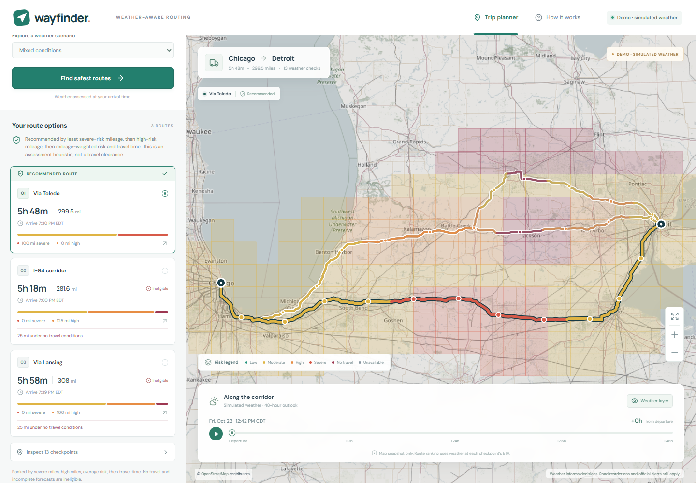
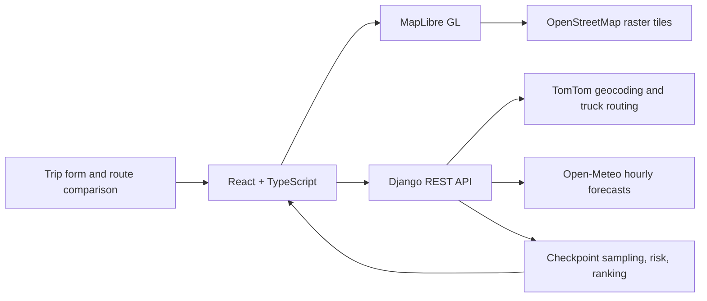

# Wayfinder

Weather-aware truck route planning for the United States. Compare route alternatives using the conditions expected **when the truck reaches each checkpoint**, then explore how weather risk changes across the route corridor over the next 48 hours.



Built with React, TypeScript, Vite, MapLibre GL, Django, and Django REST Framework. Live routing and geocoding use TomTom; forecasts use Open-Meteo.

[Public repository](https://github.com/xdeelord24/wayfinder-weather-routing)

## Try it

The application includes a clearly labeled **Chicago → Detroit demo** with three saved OSRM driving routes and synthetic weather. Route geometry and travel-time data were captured on October 23, 2026 UTC; no OSRM requests run while using the app. Choose Mixed conditions, Clear skies, or No travel conditions for repeatable examples. It works without a TomTom key. Demo results are not current forecasts, and the saved driving routes do not verify truck restrictions.

For live trips, configure `TOMTOM_API_KEY`, select real origin and destination suggestions, enter a departure within the next 48 hours, and choose a cargo load and checkpoint spacing of 10, 25, or 50 miles. The default spacing is 25 miles. Departure is interpreted in the origin's displayed timezone.

The current delivery focuses on the working demo. Live TomTom verification and hosted deployment are deferred at the user's request. Submission and verification status is recorded in [docs/VERIFICATION.md](docs/VERIFICATION.md). Deployment instructions and the presentation script are in [docs/DEPLOYMENT.md](docs/DEPLOYMENT.md) and [docs/WALKTHROUGH.md](docs/WALKTHROUGH.md).

Verified on October 24, 2026 (Asia/Manila): **32 backend tests, 15 frontend tests, production build, all three demo scenarios over HTTP, and desktop/mobile browser checks passed**. All 49 forecast positions preserve the map and recommendation without additional API requests. [The initial published CI run](https://github.com/xdeelord24/wayfinder-weather-routing/actions/runs/39989253468) also passed its Docker build and Gunicorn-container API smoke check; see the evidence record for revision-specific scope.

## Local development

Recommended runtimes: Node.js 22 and Python 3.12, matching the Docker image. The commands below use Windows PowerShell; use `npm` instead of `npm.cmd` and your virtual environment's `bin/python` on macOS or Linux.

Backend, from the repository root:

```powershell
python -m venv .venv
.\.venv\Scripts\python.exe -m pip install -r requirements.txt
Copy-Item .env.example .env
# Edit .env and add TOMTOM_API_KEY for live mode. Demo needs no key.
.\.venv\Scripts\python.exe backend/manage.py runserver 127.0.0.1:8000
```

Frontend, in a second terminal:

```powershell
cd frontend
npm.cmd ci
npm.cmd run dev
```

Open the URL printed by Vite. Development API requests are proxied to Django. Keep `.env` private; the TomTom key belongs on the backend and must never use a `VITE_` prefix.

After installing dependencies, Windows users can also run `powershell -ExecutionPolicy Bypass -File scripts/dev.ps1` from the repository root to start both development services. Ctrl+C stops that script's backend process as well.

| Backend environment | Local setting / purpose |
| --- | --- |
| `DJANGO_SECRET_KEY` | Set a long random value; use a separate production secret. |
| `DJANGO_DEBUG` | `true` locally; `false` in production. |
| `DJANGO_ALLOWED_HOSTS` | `127.0.0.1,localhost` locally; deployed hostname in production. |
| `TOMTOM_API_KEY` | Blank for demo; your private TomTom key for live routing. |

The backend reads `.env` from the repository root. No database setup or migrations are required.

To change local map tiles, set `VITE_MAP_TILE_URL` and `VITE_MAP_ATTRIBUTION` together in `frontend/.env.local`. These are frontend build-time settings; restart Vite or rebuild after changing them. Keep required map attribution visible.

## How the recommendation works

1. Request TomTom's fastest truck route and up to two alternatives. When fewer than three distinct routes are available, try the short-route option and then fastest with toll avoidance, with a maximum of three routing requests. Deduplicate routes and report any remaining shortfall.
2. Sample the route at the selected mileage interval, always including origin and destination. Interpolate checkpoint positions and arrival times using the provider's cumulative distance and travel-time data. The final arrival equals departure plus the provider's complete route duration.
3. Look up hourly weather at every checkpoint's estimated arrival. Interpolate instantaneous wind between forecast times. Use the precipitation interval containing the arrival time, combine rain and showers, and convert snowfall independently. Classify using unrounded values.
4. Apply the rules below, then assign each checkpoint the route mileage extending halfway to its neighbors. These sections partition the complete route and estimate exposure miles without overcounting endpoints.
5. Exclude any route with a **No Travel** checkpoint or an unavailable required forecast. Rank eligible routes by fewest Severe miles, fewest High miles, lowest distance-weighted average risk, then shortest travel time. If none qualify, show the reason and make no recommendation.

The assessment's overlapping thresholds are resolved as these explicit intervals:

| Weather | Low | Moderate | High | Severe | No Travel |
| --- | --- | --- | --- | --- | --- |
| Wind, mph | <25 | 25–<35 | 35–<45 | 45–<55 | ≥55 |
| Rain, inches/hour | <0.10 | 0.10–<0.25 | 0.25–<0.50 | 0.50–1.00 | >1.00 |
| Snow, inches/hour | <0.5 | 0.5–<1 | 1–<2 | 2–3 | >3 |

Cargo modifies wind risk using strict load cutoffs:

- Wind **≥55 mph**: No Travel at every load.
- Wind **45–<55 mph** and cargo **>30,000 lb**: No Travel.
- Wind **35–<45 mph** and cargo **>40,000 lb**: Severe.

Exactly 30,000 lb and exactly 40,000 lb do not trigger their corresponding escalation. A checkpoint takes the highest risk from wind, rain, snow, and applicable load escalation. Cargo weight is not passed to TomTom as total vehicle weight; the app does not invent truck dimensions.

Average risk uses Low = 0, Moderate = 1, High = 2, Severe = 3, and No Travel = 4, weighted by exposure mileage. An unknown forecast produces an unavailable average rather than a zero score.

## Map and time controls

The map shows alternative routes, a selected route's risk sections, and checkpoints with arrival time, forecast values, and risk reasons. Comparison cards show distance, duration, arrival, and estimated exposure by severity.

The corridor overlay covers a 20-mile buffer around the combined routes with an adaptive grid capped at 200 cells. The interface reports the resulting grid resolution. Its 49 hourly frames cover **departure +0 through +48 hours**, including both endpoints. Frames load separately from route results; moving the slider updates colors locally and does not rerank routes. Route recommendations always use checkpoint arrival times.

Unavailable forecasts have their own visual state. They are never treated as Low risk. A trip can start within the allowed departure window yet arrive beyond the available forecast horizon; those missing checkpoint forecasts make that route ineligible.

## Architecture and API



| Endpoint | Request | Response |
| --- | --- | --- |
| `GET /api/health` | No body | Service status and whether routing is configured |
| `GET /api/locations` | Query parameters `q` and `mode=demo\|live` | `locations`, with IDs, labels, coordinates, and IANA timezones |
| `POST /api/plan` | `origin`, `destination`, `departure`, `load_lbs`, `spacing_miles`, `mode`, optional demo `scenario` | Plan ID, routes, checkpoints, arrival forecasts, exposure, recommendation, and warnings |
| `POST /api/corridor` | `{ "plan_id": "<id from /api/plan>" }` | Corridor GeoJSON, 49 forecast frames, resolution, and warnings |

Each location is `{ id, label, lat, lon, timezone }`; `departure` is an ISO 8601 timestamp with an explicit UTC offset. Cargo must be finite and nonnegative; the form accepts up to 200,000 lb. Spacing accepts 10/25/50 miles, and demo scenarios are `mixed`, `clear`, or `blocked`. API paths have no trailing slash. See [frontend/src/types.ts](frontend/src/types.ts) for the complete response types.

The backend owns provider credentials, request validation, bounded provider timeouts, throttling, and short-lived caching. The frontend uses typed models with explicit weather units and forecast availability. Live location selections expire with their 24-hour location cache and must then be selected again. Plans are held in process memory for up to one hour; an expired or evicted plan returns HTTP 410 from `/api/corridor` and must be planned again. Errors use an `{ error: { code, message } }` envelope. There are no accounts or persistent trip records. The production Docker image serves the React build and API from a single Django service.

## Verification

The test suite targets threshold boundaries, strict cargo cutoffs, mixed hazards, mileage conservation, ETA interpolation, timezone handling, missing forecasts, route deduplication, and ranking. Browser checks cover desktop/mobile layouts, route and checkpoint selection, checkpoint spacing, and locally animated forecast frames.

```powershell
# Repository root
.\.venv\Scripts\python.exe backend/manage.py test routing.tests
.\.venv\Scripts\python.exe backend/manage.py check
# With the backend running on 127.0.0.1:8000
.\.venv\Scripts\python.exe scripts/smoke.py

cd frontend
npm.cmd test
npm.cmd run build
```

The HTTP smoke script exercises mixed/25-mile, clear/10-mile, and blocked/50-mile scenarios, checking corridor size/frame count, total exposure mileage, final arrival, and moving weather fronts. Pass an optional base URL to test another port: `.venv\Scripts\python.exe scripts/smoke.py http://127.0.0.1:8001`. Add `--frontend` when the backend serves the built frontend to check the HTML title and JavaScript/CSS entry assets, including response types and content.

GitHub Actions runs backend tests/checks, frontend tests/build, static collection, a Docker image build, and the HTTP smoke test against the container. The initial published revision passed these checks. The added `--frontend` HTML/assets checks passed locally and await the next container CI run.

See [the verification record](docs/VERIFICATION.md) for commands actually run, results, and remaining live checks. Passing fixture tests does not establish that external providers or a hosted deployment work.

## Assumptions and limits

- The rules implement this assessment's risk model. They do not account for every operational factor, such as driver breaks, wind direction relative to the vehicle, vehicle dimensions, or road closures beyond the routing provider's data.
- Checkpoint sampling and grid cells estimate exposure between forecast locations; they do not provide continuous observations along every road segment.
- Live provider failures are shown explicitly. The application never silently substitutes demo data.
- Public third-party services have quotas and availability limits. No account, API credit purchase, or paid hosting is required for the fixture demo.

## Data and attribution

- **Routing and geocoding:** [TomTom Routing API](https://docs.tomtom.com/routing-api/documentation/tomtom-maps/v1/calculate-route); a server-side API key is required for live trips.
- **Saved demo routes:** [OSRM Route service](https://project-osrm.org/docs/v5.24.0/api/#route-service), using © [OpenStreetMap contributors](https://www.openstreetmap.org/copyright) road data under the [Open Database License](https://opendatacommons.org/licenses/odbl/1-0/). Saved driving geometry and travel-time annotations are bundled for repeatability; demo weather is generated synthetically.
- **Forecasts:** [Open-Meteo](https://open-meteo.com/en/docs), with visible attribution. Review [Open-Meteo's terms and pricing](https://open-meteo.com/en/pricing) before commercial use.
- **Base map:** © [OpenStreetMap contributors](https://www.openstreetmap.org/copyright). Respect the [tile usage policy](https://operations.osmfoundation.org/policies/tiles/); attribution stays visible, browser caching is respected, and no bulk download or offline tile prefetch is implemented.

The source assessment PDF and local credentials are excluded from the public repository.
